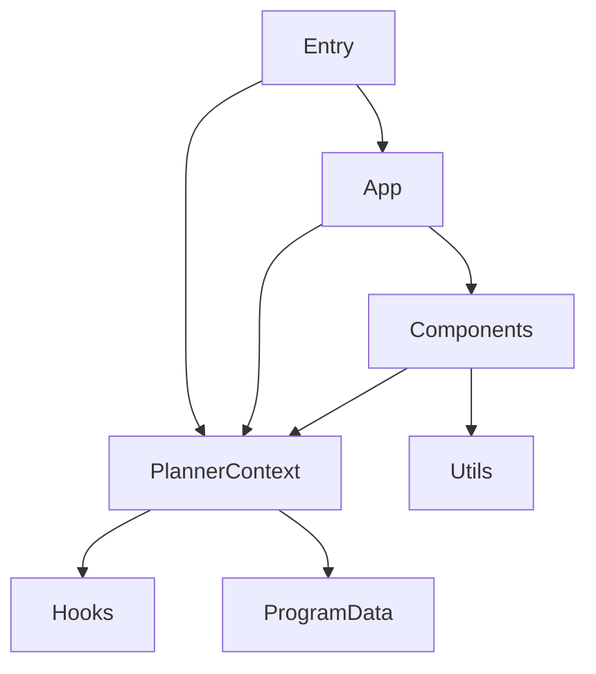

## 1. Stack
- React 18 (`react`, `react-dom` ^18.3.1) + Vite 6 (`vite` ^6.4.4, `@vitejs/plugin-react` ^4.3.4) — package.json
- Plain JS (`.jsx`/`.js`), ES modules (`"type": "module"` — package.json)
- Pure CSS, no CSS framework (README: "Pure CSS ... no framework")
- Persistence: browser localStorage (README; src/hooks/useLocalStorage.js)
- CI/CD: GitHub Actions → GitHub Pages (.github/workflows/deploy.yml — README)

## 2. Directory map

| path | what lives there |
|---|---|
| src/main.jsx | app entry — mounts `App` inside `PlannerProvider` |
| src/App.jsx | root component — program gate + tab routing (career/courses/planner) |
| src/components/ | UI components: Header, TabNav, ProgressDashboard, CareerPathSelector, MajorTrackSelector, CourseList, CourseCard, SemesterPlanner, ProgramSelector |
| src/context/ | PlannerContext.jsx — global planner state (React Context) |
| src/data/programs/ | per-program course catalogs: cse.js, dataScience.js, cncs.js, index.js |
| src/hooks/ | useLocalStorage.js — persistence hook |
| src/utils/ | credits.js, exportPdf.js, graduation.js, prerequisites.js — planning logic |
| src/index.css | dark-theme CSS variables + layout (README) |
| public/ | static assets — aiub-logo.svg, favicon.svg |
| .github/workflows/ | deploy.yml — build & deploy to GitHub Pages on push to main |

## 3. Diagram

## 4. Component index
- [[Entry]]
- [[App]]
- [[PlannerContext]]
- [[Components]]
- [[ProgramData]]
- [[Hooks]]
- [[Utils]]

## 5. Entry points
- Dev: `npm run dev` (package.json scripts.dev = `vite`) → serves index.html → `<script src="/src/main.jsx">` (index.html)
- Prod build: `npm run build` (scripts.build = `vite build`); preview via `npm run preview` (package.json)
- Deploy: push to `main` triggers `.github/workflows/deploy.yml` → GitHub Pages (README)

## 6. Conventions
- Components are default-exported, one per file, PascalCase filenames under src/components/ (observed in App.jsx imports: `import Header from './components/Header'`, etc.)
- Global state lives in a single React Context (src/context/PlannerContext.jsx), consumed via a `usePlanner()` hook (observed in App.jsx: `import { usePlanner } from './context/PlannerContext'`)
- App root wrapped in `<React.StrictMode>` (src/main.jsx)
- App gates all UI on `program` being selected before rendering the main layout (src/App.jsx: `if (!program) { ... ProgramSelector ... }`)
- Vite `base` must equal the repo name for GitHub Pages (README note re: vite.config.js)

## 7. Where things go
- New program (e.g. a 4th degree track): add a file to src/data/programs/, register it in src/data/programs/index.js
- New tab/section in the UI: add a component to src/components/, wire it into the tab switch in src/App.jsx and into src/components/TabNav.jsx
- New planning/eligibility rule (credits, prerequisites, graduation math): add to src/utils/
- New piece of persisted state: extend src/context/PlannerContext.jsx, backed by src/hooks/useLocalStorage.js
- New CI/deploy step: edit .github/workflows/deploy.yml
